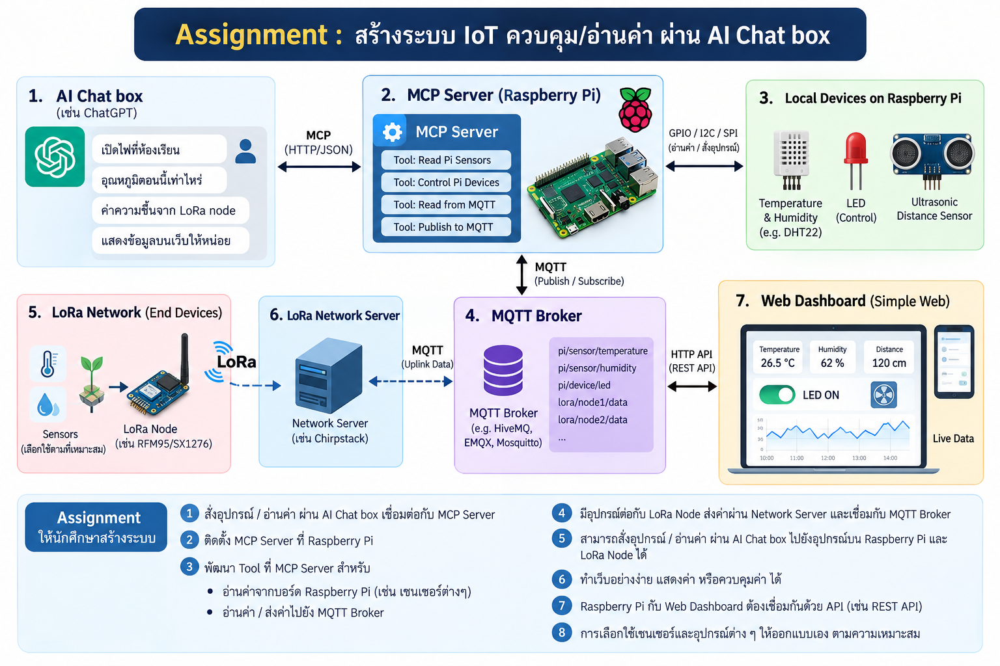

# Internet of Things assignment

### สร้างระบบ IoT ควบคุม/อ่านค่า ผ่าน AI Chatbot

ระบบ IoT ที่สั่งงานและอ่านค่าอุปกรณ์ได้สองทาง คือพิมพ์คุยกับ **ChatGPT** (ผ่าน MCP server บน Raspberry Pi) และใช้ **เว็บ dashboard** โดยค่าอุณหภูมิ/ความชื้นมาจาก **LoRa node** (Arduino UNO R4 WiFi + Cytron LoRa-RFM shield 915 MHz + SHT31) ที่ส่งผ่าน LoRaWAN

## โจทย์



## สารบัญ

1. [สถาปัตยกรรม](#architecture)
2. [ต้องต่ออะไรยังไง](#wiring)
3. [วิธีใช้งาน](#usage)
4. [แก้ปัญหา](#troubleshooting)
5. [โจทย์แต่ละข้อทำไว้ที่ไหน](#mapping)
6. [โครงสร้างโปรเจกต์](#structure)
7. [ความปลอดภัย](#security)

---

<a id="architecture"></a>

## 1. สถาปัตยกรรม

### 1.1 ภาพรวม

```
             LoRa                MQTT
LoRa node ─────────► ChirpStack ─────► lora.kmitl.ac.th
(UNO R4 + LoRa shield)  (network server)      │
                                              │  MQTT 1883 (Pi subscribes)
                                              │
              MCP (HTTPS tunnel)              ▼         GPIO
ChatGPT ──────────────────────────────► Raspberry Pi ──────────► HC-SR04 / Light sensor / RGB LED
(AI Chat box)                              │    ▲    (MCP server)
                                           │    │
                                           │    │  MQTT 1883
                                           │    │  (publish / subscribe)
                                           │    │
                                           ▼    │       MQTT                HTTP (REST)
                                  mqtt-dashboard.com ◄────────► Web server ◄───────────► Browser
                                  (public broker)               (SvelteKit + Hono)
```

### 1.2 ส่วนประกอบและหน้าที่

| ส่วน | อยู่ที่ | หน้าที่ |
|---|---|---|
| ChatGPT | ภายนอก | รับคำสั่งภาษาธรรมชาติ แล้วเรียก MCP tool |
| MCP server | `RasPi/server.py` | เปิด tool ให้ ChatGPT, คุม GPIO, เก็บค่าล่าสุดของเซนเซอร์ |
| MQTT bridge | `RasPi/server.py` | รับอุณหภูมิ/ความชื้นจาก `lora.kmitl.ac.th` แล้ว publish ต่อไป `mqtt-dashboard.com` |
| Sensor modules | `RasPi/sensor/` | `rgb.py`, `ultrasonic.py`, `light.py` ห่อการเข้าถึง GPIO |
| LoRa node | `LoRa/LoRa.ino` | อ่าน SHT31 แล้วส่ง uplink ผ่าน LoRaWAN (OTAA) |
| ChirpStack | เครือข่าย LoRaWAN | รับ uplink จาก gateway แล้ว publish เข้า MQTT |
| Web server | `Web/` | เก็บค่าและประวัติจาก MQTT, เปิด REST API (Hono), เสิร์ฟหน้าเว็บ |
| Browser | ผู้ใช้ | แสดงผลและส่งคำสั่งผ่าน REST API |

### 1.3 การเชื่อมต่อระหว่างส่วนต่างๆ

| จาก | ไปที่ | โปรโตคอล | หมายเหตุ |
|---|---|---|---|
| LoRa node | gateway / ChirpStack | LoRaWAN (OTAA) ช่อง 923.2 MHz | ต้องมี gateway ครอบคลุมพื้นที่ |
| ChirpStack | `lora.kmitl.ac.th` | MQTT พอร์ต 1883 | publish uplink |
| Raspberry Pi | `lora.kmitl.ac.th` | MQTT พอร์ต 1883 | subscribe uplink |
| Raspberry Pi | `mqtt-dashboard.com` | MQTT พอร์ต 1883 | publish ค่า / subscribe คำสั่งไฟ |
| Web server | `mqtt-dashboard.com` | MQTT พอร์ต 1883 | subscribe ค่า / publish คำสั่งไฟ |
| Browser | Web server | HTTP พอร์ต 3000 | REST API และหน้าเว็บ |
| ChatGPT | Raspberry Pi | HTTPS ผ่าน tunnel ไปพอร์ต 8000 path `/mcp` | MCP (streamable HTTP) |

### 1.4 Data flow หลัก

**สั่งไฟจาก ChatGPT**

```
            MCP: set_rgb_color(blue)                      GPIO
ChatGPT ────────────────────────────────► Raspberry Pi ─────────► RGB LED
(AI Chat box)                                  │
                                               │  publish PREFIX/rgb/state (retained)
                                               ▼
                                      mqtt-dashboard.com
```

**สั่งไฟจากเว็บ** (1) คำสั่งไปที่ Pi (2) Pi รายงานสถานะกลับมาให้เว็บแสดง

```
(1) command
            POST /api/rgb                 publish PREFIX/rgb/set
Browser ────────────────────► Web server ───────────────────────► mqtt-dashboard.com
                                                                          │
                                                                          │  subscribe rgb/set
                                                         GPIO             ▼
                                            RGB LED ◄────────────── Raspberry Pi

(2) feedback
               publish PREFIX/rgb/state (retained)
Raspberry Pi ───────────────────────────────────────► mqtt-dashboard.com
                                                              │
                                                              │  subscribe rgb/state
                                    GET /api/state (1 s)      ▼
                            Browser ◄──────────────────► Web server
```

**อุณหภูมิ/ความชื้นจาก LoRa node** (อ่านจากขวาไปซ้ายที่แถวล่าง)

```
        I2C                                LoRa                 MQTT
SHT31 ──────► UNO R4 WiFi + LoRa shield ─────────► ChirpStack ───────► lora.kmitl.ac.th
                                                                              │
                                                                              │  subscribe
                                                                              │
         HTTP                MQTT                        temp, humid          ▼
Browser ◄─────► Web server ◄──────► mqtt-dashboard.com ◄─────────────── Raspberry Pi
                                                         (PREFIX/temp, PREFIX/humid)
```

**อ่านเซนเซอร์บน Pi** thread `sensor_loop` อ่านระยะห่างและแสงทุก 1 วินาที เก็บค่าล่าสุดไว้และ publish ไปที่ `mqtt-dashboard.com` ส่วน tool `get_distance` ตอบจากค่าที่เก็บไว้ทันที

### 1.5 โครงสร้างภายในแต่ละส่วน

**Raspberry Pi (`RasPi/server.py`)** แสดงเส้นทางของข้อมูลที่เข้าและออกจากโปรแกรม

```
ChatGPT ──MCP──► set_rgb_color ──► apply_rgb() ──┬──► rgb.py ──GPIO──► RGB LED
                                                 └──► publish PREFIX/rgb/state (retained)

mqtt-dashboard.com ──PREFIX/rgb/set──► client dash ──► apply_rgb()

sensor_loop (every 1 s) ──┬──► ultrasonic.py / light.py ──► state ──► get_distance
                          └──► publish PREFIX/distance, PREFIX/light

lora.kmitl.ac.th ──uplink──► client lora ──► decode ──┬──► state ──► get_temperature / get_humidity
                                                      └──► publish PREFIX/temp, PREFIX/humid
```

| ส่วน | ทำอะไร |
|---|---|
| MCP server | เปิด 6 tool ให้ ChatGPT (พอร์ต 8000, path `/mcp`) |
| `apply_rgb()` | จุดเดียวที่สั่งไฟ: ตั้งขา GPIO แล้ว publish สถานะ `PREFIX/rgb/state` (retained) ทั้ง ChatGPT และเว็บใช้ฟังก์ชันนี้ |
| `sensor_loop` | thread แยก อ่าน ultrasonic และ light ทุก 1 วินาที เก็บใน `state` แล้ว publish |
| `state` + `state_lock` | ค่าล่าสุด (ระยะห่าง, อุณหภูมิ, ความชื้น, เวลาที่ได้ uplink) หลาย thread ใช้ร่วมกันจึงมี lock |
| client `dash` | MQTT client ต่อ `mqtt-dashboard.com` รับคำสั่งจากเว็บและส่งค่าออก |
| client `lora` | MQTT client ต่อ `lora.kmitl.ac.th` รับ uplink แล้วถอดค่าอุณหภูมิ/ความชื้น |

- `get_distance`, `get_temperature`, `get_humidity` ตอบจากค่าใน `state` จึงไม่ต้องรอการวัด ส่วน `get_light_status` อ่านขา GPIO ตรงๆ
- ตอนเชื่อม `mqtt-dashboard.com` สำเร็จ (และตอน reconnect) โปรแกรมจะ publish สีไฟปัจจุบันซ้ำและ subscribe `rgb/set` ใหม่

**Web server (`Web/`)**

```
Browser ──GET  /api/state (1 s) ────┐
        ──GET  /api/history (5 s)───┼──► hooks.server.js ──/api/*──► api.js (Hono) ──► mqtt.js
        ──POST /api/rgb─────────────┘                                                   │   ▲
                                                                            MQTT 1883   │   │
                                                                                        ▼   │
                                                                                   mqtt-dashboard.com
```

| ไฟล์ | หน้าที่ |
|---|---|
| `src/hooks.server.js` | ส่งทุก request ที่ขึ้นต้นด้วย `/api/` ให้ Hono ส่วนที่เหลือเป็นหน้าเว็บของ SvelteKit และการ import ไฟล์นี้ทำให้ MQTT เริ่มต่อตั้งแต่ server สตาร์ต |
| `src/lib/server/api.js` | Hono routes: `/api/state`, `/api/history`, `/api/rgb` |
| `src/lib/server/mqtt.js` | MQTT client ตัวเดียว subscribe ค่าจากเซนเซอร์ เก็บค่าล่าสุดและประวัติ (อุณหภูมิ/ความชื้น 24 ชั่วโมง) ในหน่วยความจำ และ publish คำสั่งไฟ |
| `src/routes/+page.svelte` | หน้า dashboard ดึง `/api/state` ทุก 1 วินาที และ `/api/history` ทุก 5 วินาที |
| `src/lib/Chart.svelte` | กราฟเส้นแบบ SVG วัดความกว้างจริงของกรอบ และมี tooltip ตอนชี้ |

เบราว์เซอร์ไม่ได้คุยกับ MQTT broker ตรงๆ แต่เรียก REST API ของ Hono ซึ่งต่อ broker ให้ (ตามที่โจทย์กำหนดให้เว็บเชื่อมด้วย API) MQTT client มีตัวเดียวต่อหนึ่ง server และเลขประจำ client สุ่มต่อท้ายทุกครั้ง จึงเปิดหลายอินสแตนซ์พร้อมกันได้โดยไม่แย่ง connection กัน

**LoRa node (`LoRa/LoRa.ino`)**

```
setup(): init SHT31 + LMIC (AS923, 923.2 MHz)
   │
   ▼
do_send() ───► read SHT31 ───► pack 4 bytes ───► LMIC_setTxData2(port 1) ───► uplink
   ▲               │ read failed                                                │
   │               ▼                      next round                            ▼
   └─ wait TX_INTERVAL ◄─────────────────────────────────────────────── EV_TXCOMPLETE
```

- **OTAA:** node ส่งคำขอ join ด้วย `APPEUI`, `DEVEUI`, `APPKEY` ในการส่งครั้งแรก แล้วเครือข่ายสร้าง session key ให้เอง
- **ส่งอย่างเดียว:** node ส่งข้อมูลขึ้น (uplink) ยังไม่รับคำสั่งกลับ (downlink)
- **ตั้งเวลาด้วย LMIC:** หลังส่งเสร็จ (`EV_TXCOMPLETE`) จะตั้งเวลาเรียก `do_send` รอบถัดไป ถ้าอ่านเซนเซอร์ไม่ได้ก็ข้ามรอบนั้น

### 1.6 แนวคิดการออกแบบ

- **Pi เป็นศูนย์กลาง:** ทุกอย่างผ่าน Pi เว็บต่อ broker เดียว ไม่ต้องรู้จัก LoRa และ ChatGPT ต่อกับ Pi ที่เดียว
- **สถานะไฟมีแหล่งความจริงเดียว** คือ `PREFIX/rgb/state` (retained) ทั้ง ChatGPT และเว็บสั่งผ่านฟังก์ชัน `apply_rgb` ตัวเดียวกัน เมื่อเปิดเว็บใหม่จึงเห็นสีปัจจุบันทันที
- **ใช้ retained message กับค่าที่เปลี่ยนไม่บ่อย** (สีไฟ, แสง, อุณหภูมิ, ความชื้น) ผู้ subscribe ใหม่จึงได้ค่าล่าสุดทันที ส่วนระยะห่างไม่ retained เพราะเปลี่ยนทุกวินาที และเว็บใช้การที่ไม่มีค่าใหม่เกิน 5 วินาทีเป็นสัญญาณว่า Pi ไม่ออนไลน์
- **Tool ตอบจากค่าที่เก็บไว้:** การวัดทำใน thread แยก tool จึงไม่ต้องรอการวัดและไม่แย่งใช้เซนเซอร์กัน
- **แยก broker 2 ตัว:** `lora.kmitl.ac.th` เป็นฝั่งเครือข่าย LoRa (อ่านอย่างเดียว) ส่วน `mqtt-dashboard.com` เป็นของระบบเราเอง
- **Payload LoRa เล็กมาก (4 ไบต์)** เพื่อลดเวลาส่งในอากาศ (airtime)
- **เว็บใช้ REST + polling:** ง่ายกว่า WebSocket/SSE และเพียงพอกับค่าที่เปลี่ยนไม่ถี่ ประวัติกราฟเก็บในหน่วยความจำของ server

### 1.7 MQTT topic

Broker ทั้งสองใช้พอร์ต 1883 ไม่ต้องใช้ username/password

**`mqtt-dashboard.com`** (`PREFIX` ตั้งไว้เป็น `67070164`)

| Topic | ทิศทาง | Payload | Retained |
|---|---|---|---|
| `PREFIX/rgb/set` | เว็บ → Pi | `red` `yellow` `green` `cyan` `blue` `magenta` `white` `off` | ไม่ |
| `PREFIX/rgb/state` | Pi → เว็บ | สีปัจจุบัน หรือ `off` | ใช่ |
| `PREFIX/distance` | Pi → เว็บ | ระยะห่าง (cm) ทุก 1 วินาที | ไม่ |
| `PREFIX/light` | Pi → เว็บ | `bright` หรือ `dark` | ใช่ |
| `PREFIX/temp` | Pi → เว็บ | อุณหภูมิ (°C) จาก LoRa | ใช่ |
| `PREFIX/humid` | Pi → เว็บ | ความชื้น (%RH) จาก LoRa | ใช่ |

**`lora.kmitl.ac.th`:** Pi subscribe `application/<APP_ID>/device/<DEV_EUI>/event/up`

### 1.8 ข้อจำกัด

- LoRa node **ส่งข้อมูลขึ้นอย่างเดียว** (uplink) ยังไม่มีการสั่งงานกลับไปที่ node
- ค่าอุณหภูมิ/ความชื้นอัปเดตตามรอบที่ node ส่ง ซึ่งช้ากว่าเซนเซอร์บน Pi
- ประวัติกราฟอยู่ในหน่วยความจำ หายเมื่อรีสตาร์ตเว็บ server
- Broker สาธารณะและ MCP endpoint ไม่มีการยืนยันตัวตน (ดู [ความปลอดภัย](#security))

---

<a id="wiring"></a>

## 2. ต้องต่ออะไรยังไง

### 2.1 อุปกรณ์ทั้งหมด

| อุปกรณ์ | จำนวน | ต่อกับ |
|---|---|---|
| Raspberry Pi 4 | 1 | รัน MCP server |
| Arduino UNO R4 WiFi | 1 | LoRa node |
| Cytron LoRa-RFM shield (915 MHz) | 1 | เสียบทับ UNO R4 WiFi |
| เสาอากาศ LoRa (รองรับย่าน 915 MHz) | 1 | ต่อกับ shield |
| SHT31 (อุณหภูมิ/ความชื้น, I2C) | 1 | Arduino |
| RGB LED (common anode) | 1 | Raspberry Pi |
| HC-SR04 (ultrasonic) | 1 | Raspberry Pi |
| Light sensor module (digital output) | 1 | Raspberry Pi |
| ตัวต้านทาน 220 Ω | 3 | ต่ออนุกรมกับขา R/G/B ของ RGB LED |
| ตัวต้านทาน 1 kΩ และ 2 kΩ | อย่างละ 1 | ตัวแบ่งแรงดันที่ขา ECHO ของ HC-SR04 |

### 2.2 Raspberry Pi: HC-SR04, RGB LED, Light sensor

ใช้เลขขาแบบ **BOARD** (เลขขาบนหัว pin ของบอร์ด) ขา 3V3/5V/GND ใช้ขาอื่นที่เป็นไฟชนิดเดียวกันแทนได้

**HC-SR04 (ultrasonic)**

```
HC-SR04                               Raspberry Pi 4 (BOARD pin)
  VCC  ─────────────────────────────── Pin 2  (5V)
  TRIG ─────────────────────────────── Pin 11 (GPIO17)
  ECHO ──[ 1 kΩ ]──┬────────────────── Pin 13 (GPIO27)
                   │
                [ 2 kΩ ]
                   │
  GND  ────────────┴─────────────────── Pin 6  (GND)
```

**RGB LED (common anode)**

```
RGB LED (common anode)                Raspberry Pi 4 (BOARD pin)
  common (longest leg) ─────────────── Pin 1  (3V3)
  R ──[ 220 Ω ] ────────────────────── Pin 15 (GPIO22)
  G ──[ 220 Ω ] ────────────────────── Pin 16 (GPIO23)
  B ──[ 220 Ω ] ────────────────────── Pin 18 (GPIO24)
```

**Light sensor module**

```
Light sensor module                   Raspberry Pi 4 (BOARD pin)
  VCC ──────────────────────────────── Pin 17 (3V3)
  DO  ──────────────────────────────── Pin 22 (GPIO25)
  GND ──────────────────────────────── Pin 9  (GND)
```

สรุปขา GPIO ที่โค้ดใช้ (`sensor/*.py`)

| อุปกรณ์ | ขาของอุปกรณ์ | Raspberry Pi (BOARD) | GPIO (BCM) |
|---|---|---|---|
| HC-SR04 | TRIG | 11 | GPIO17 |
| HC-SR04 | ECHO (ผ่านตัวแบ่งแรงดัน) | 13 | GPIO27 |
| RGB LED | R | 15 | GPIO22 |
| RGB LED | G | 16 | GPIO23 |
| RGB LED | B | 18 | GPIO24 |
| Light sensor | DO | 22 | GPIO25 |

**ข้อควรระวังในการต่อ**

- **ตัวแบ่งแรงดันที่ ECHO ห้ามข้าม:** ECHO ของ HC-SR04 ส่งสัญญาณ 5V แต่ GPIO ของ Pi ทนได้ 3.3V ต่อ ECHO ผ่านตัวต้านทาน 1 kΩ ไปยังจุดกลาง จากจุดกลางต่อตัวต้านทาน 2 kΩ ลง GND และต่อจุดกลางเข้าขา 13 ตามรูป ถ้าต่อตรงอาจทำให้ Pi เสีย
- **RGB LED เป็น common anode:** ขา common ต่อ 3.3V ไฟสีนั้นจะ**ติดเมื่อสั่งขาเป็น LOW (0)** ค่าตัวต้านทาน 220 Ω เป็นค่าโดยประมาณ ปรับตาม LED ที่ใช้
- **Light sensor:** DO เป็น HIGH เมื่อ**มืด** และ LOW เมื่อสว่าง ปรับความไวด้วยตัวต้านทานปรับค่าบนโมดูล (ไม่ได้ใช้ขา AO)
- ตรวจแรงดันไฟเลี้ยงของโมดูลตามสเปกที่ซื้อมาอีกครั้งก่อนจ่ายไฟ

**สีไฟ RGB** (ค่าขา R, G, B เป็น 0 = ติด)

| สี | ค่าขา (R, G, B) |
|---|---|
| red | 0, 1, 1 |
| yellow | 0, 0, 1 |
| green | 1, 0, 1 |
| cyan | 1, 0, 0 |
| blue | 1, 1, 0 |
| magenta | 0, 1, 0 |
| white | 0, 0, 0 |
| off | 1, 1, 1 |

ถ้าใช้ RGB LED แบบ common cathode ต้องกลับค่า 0/1 ทั้งหมดใน `RGB_COLORS` (ไฟล์ `RasPi/sensor/rgb.py`) และเปลี่ยน `initial=1` ใน `setup()` เป็น `0`

### 2.3 Arduino UNO R4 WiFi: Cytron LoRa shield และ SHT31

**LoRa:** เสียบ **Cytron LoRa-RFM shield (915 MHz)** ทับบน UNO R4 WiFi และต่อเสาอากาศเข้ากับ shield ไม่ต้องต่อสายระหว่าง shield กับบอร์ด

```
       antenna
          │
  ┌───────┴────────────────┐
  │ Cytron LoRa-RFM shield │   plugs on top of the UNO (no jumper wires)
  │ (RFM, 915 MHz)         │
  ├────────────────────────┤
  │ Arduino UNO R4 WiFi    │ ◄── USB (power, upload, Serial Monitor)
  └────────────────────────┘
```

**SHT31:** ต่อสายเข้าที่ขา I2C ของบอร์ด

```
SHT31                             UNO R4 WiFi (shield stacked on top)
  VIN ──────────────────────────── 3.3V
  GND ──────────────────────────── GND
  SDA ──────────────────────────── A4 (SDA)
  SCL ──────────────────────────── A5 (SCL)
```

**ข้อควรระวังในการต่อ**

- **ต่อเสาอากาศก่อนจ่ายไฟ (USB) ทุกครั้ง** การส่งสัญญาณโดยไม่มีเสาอากาศอาจทำให้โมดูลเสียหาย และควรใช้เสาอากาศที่รองรับย่าน 915 MHz
- ขาที่ shield ใช้ต้องตรงกับ `lmic_pins` ใน `LoRa.ino`

  | สัญญาณ | ขา |
  |---|---|
  | NSS | D10 |
  | RST | D7 |
  | DIO0 / DIO1 / DIO2 | D2 / D5 / D6 |
  | SCK / MISO / MOSI | D13 / D12 / D11 (SPI ของบอร์ด) |

  ถ้า node join ไม่ได้ ให้เทียบกับเอกสาร pin ของ shield รุ่นที่ใช้ และแก้ `lmic_pins` ให้ตรง
- โค้ดเรียก `sht31.begin(0x44)` ซึ่งเป็น address เริ่มต้น ถ้าบอร์ด SHT31 ของคุณใช้ `0x45` ให้แก้เลขนี้
- ถ้า shield บังขา A4/A5 ให้ใช้ขา SDA/SCL ที่อยู่ใกล้ AREF แทน (เป็นบัส I2C เดียวกัน)

---

<a id="usage"></a>

## 3. วิธีใช้งาน

### 3.1 สิ่งที่ต้องมี

- Raspberry Pi 4 (Python 3) ต่อเซนเซอร์ตามหัวข้อ 2.2
- Arduino UNO R4 WiFi + Cytron LoRa shield + เสาอากาศ + SHT31 ตามหัวข้อ 2.3 และมี device ที่สร้างไว้ใน ChirpStack
- HTTPS tunnel ที่ชี้มายัง Pi (ให้ ChatGPT เข้าถึง MCP server ได้)
- เครื่องที่รันเว็บ ติดตั้ง [Bun](https://bun.sh) แล้ว และออกอินเทอร์เน็ตไป `mqtt-dashboard.com` พอร์ต 1883 ได้
- บัญชี ChatGPT ที่เพิ่ม MCP server ได้

### 3.2 ลำดับการติดตั้ง

1. **LoRa node** (หัวข้อ 3.3): ตั้ง LMIC ใส่ key อัปโหลดโค้ด แล้วดู Serial Monitor ว่า join สำเร็จ
2. **Raspberry Pi** (หัวข้อ 3.4): ติดตั้ง ตั้งค่า แล้วรัน `server.py`
3. **ChatGPT** (หัวข้อ 3.4): เปิด tunnel แล้วเพิ่ม MCP server
4. **Web dashboard** (หัวข้อ 3.5): ติดตั้ง build แล้วรัน

> `PREFIX` ใน `RasPi/server.py` และ `Web/src/lib/server/mqtt.js` ต้องเป็นค่าเดียวกัน ไม่เช่นนั้นเว็บกับ Pi จะไม่เห็นข้อมูลของกัน

### 3.3 LoRa node

**ติดตั้งไลบรารี** (Arduino IDE → Library Manager)

- **MCCI LoRaWAN LMIC library**
- **Adafruit SHT31 Library** (และ Adafruit BusIO ถ้าระบบถาม)

**ตั้งค่า LMIC** แก้ไฟล์ `lmic_project_config.h` ของไลบรารี MCCI LMIC (อยู่ในโฟลเดอร์ `libraries/MCCI_LoRaWAN_LMIC_library/project_config/`)

```c
#define CFG_as923 1
#define CFG_sx1276_radio 1
```

โมดูล RFM บน shield ใช้ชิป SX1276 จึงเลือก `CFG_sx1276_radio` (ตรวจรุ่นบน shield ถ้าไม่แน่ใจ) โค้ดตั้งช่องความถี่ไว้ที่ `923200000` Hz (AS923) ให้ตรงกับ gateway ถ้า region หรือ radio ตั้งไม่ตรง node จะ join ไม่ผ่านและอาจไม่มีข้อความแจ้งสาเหตุ

**สร้าง device ใน ChirpStack**

- สร้าง device แบบ **OTAA** ใน application ที่ต้องการ
- Device profile ใช้ MAC version แบบ LoRaWAN 1.0.x (LMIC) และ region ให้ตรงกับที่เครือข่ายใช้งาน
- เก็บ **Application ID**, **Device EUI**, **Join EUI**, **App Key** ไว้ใช้ต่อ และใส่ `APP_ID`/`DEV_EUI` ใน `RasPi/server.py`

**ใส่ key ใน `LoRa.ino`**

```cpp
static const u1_t PROGMEM APPEUI[8] = {  };  // Join EUI
static const u1_t PROGMEM DEVEUI[8] = {  };  // Device EUI
static const u1_t PROGMEM APPKEY[16] = {  }; // App Key
```

ลำดับไบต์ของ LMIC ไม่เหมือนกัน

| ค่า | ลำดับในโค้ด | ตัวอย่าง (ChirpStack แสดง → ใส่ในโค้ด) |
|---|---|---|
| `APPEUI` | **กลับด้าน** (LSB ก่อน) | `0102030405060708` → `0x08, 0x07, 0x06, 0x05, 0x04, 0x03, 0x02, 0x01` |
| `DEVEUI` | **กลับด้าน** (LSB ก่อน) | `0A0B0C0D0E0F1011` → `0x11, 0x10, 0x0F, 0x0E, 0x0D, 0x0C, 0x0B, 0x0A` |
| `APPKEY` | **ตามลำดับที่แสดง** (MSB ก่อน) | `00112233...` → `0x00, 0x11, 0x22, 0x33, ...` |

ส่วน `DEV_EUI` ใน `RasPi/server.py` ต้องเป็นค่าที่ ChirpStack แสดง (ตัวพิมพ์เล็ก ไม่กลับด้าน)

**อัปโหลดและตรวจสอบ**

1. ต่อเสาอากาศ แล้วเลือกบอร์ด **Arduino UNO R4 WiFi** และอัปโหลด
2. เปิด Serial Monitor ที่ **9600 baud**
3. ผลที่ควรเห็น

```
EV_JOINING
EV_JOINED
Packet queued: 27.6 C, 61.2 %
EV_TXCOMPLETE
```

หลัง `EV_TXCOMPLETE` node จะรอตามเวลาที่ตั้งแล้วส่งรอบถัดไป และใน ChirpStack จะเห็น uplink เข้ามาที่ device

**รูปแบบข้อมูลที่ส่ง** ส่งที่ **port 1** ขนาด **4 ไบต์** แบบ big-endian

| ไบต์ | ข้อมูล | ชนิด | หน่วย |
|---|---|---|---|
| 0–1 | อุณหภูมิ | `int16` | °C × 100 |
| 2–3 | ความชื้น | `uint16` | %RH × 100 |

ตัวอย่าง อุณหภูมิ 27.6 °C และความชื้น 61.2 %RH → 2760 และ 6120 → ส่ง `0A C8 17 E8` ฝั่ง Pi ถอดด้วย `struct.unpack(">hH", raw)` ถ้าเปลี่ยนรูปแบบข้อมูลที่นี่ ต้องแก้ `on_lora_message` ใน `RasPi/server.py` ให้ตรงกัน

**ช่วงเวลาการส่ง** `TX_INTERVAL` ตั้งไว้ที่ **10 วินาที** เหมาะกับตอนทดสอบ แต่โค้ดใช้ SF12 ซึ่งแพ็กเก็ตขนาดเล็กหนึ่งแพ็กเก็ตใช้เวลาส่งราว 1–2 วินาที และกฎ duty cycle ของ LoRaWAN ทำให้ LMIC อาจหน่วงการส่งรอบถัดไปให้นานกว่าที่ตั้ง (หลักนาที) ถ้าต้องการให้ข้อมูลอัปเดตถี่ขึ้นและ node อยู่ใกล้ gateway ให้ลดเป็น SF ที่ต่ำลง เช่น `DR_SF7` ใน `LMIC_setDrTxpow(DR_SF12, 14)` ส่วนใช้งานจริงควรเพิ่ม `TX_INTERVAL` ให้ห่างขึ้น

### 3.4 Raspberry Pi และ ChatGPT

**ติดตั้ง** dependencies

```bash
sudo apt install python3-full python3-venv
```

**ติดตั้ง** server

```bash
cd RasPi
python3 -m venv .venv
source .venv/bin/activate
pip install -r requirements.txt
```

**ตั้งค่า** แก้ตัวแปรด้านบนของ `server.py`

| ตัวแปร | ความหมาย |
|---|---|
| `PREFIX` | คำนำหน้า topic ต้องตรงกับฝั่ง Web |
| `DASH_HOST` | broker ที่ใช้กับเว็บ (`mqtt-dashboard.com`) |
| `LORA_HOST` | broker ที่รับ uplink จาก LoRa (`lora.kmitl.ac.th`) |
| `APP_ID` | Application ID จาก ChirpStack |
| `DEV_EUI` | Device EUI ของ LoRa node ตัวพิมพ์เล็ก เรียงแบบเดียวกับที่ ChirpStack แสดง |
| `TUNNEL_URL` | ชื่อโดเมนของ tunnel **ไม่ต้องมี** `https://` |

topic ที่ได้คือ `application/<APP_ID>/device/<DEV_EUI>/event/up`

**ทดสอบเซนเซอร์ทีละตัว** (แนะนำก่อนรันจริง) แต่ละไฟล์ใน `sensor/` รันเดี่ยวๆ ได้ กด Ctrl+C เพื่อหยุด

```bash
python sensor/rgb.py          # ไล่สีไฟทั้ง 8 สถานะ
python sensor/ultrasonic.py   # แสดงระยะห่างทุก 1 วินาที
python sensor/light.py        # แสดง [BRIGHT] / [DARK]
```

**รัน** server

```bash
python server.py
```

ถ้าเชื่อม broker สำเร็จจะเห็น

```
[CONNECTED] Dashboard broker connected
[CONNECTED] LoRa broker connected
```

และเมื่อ LoRa node ส่งข้อมูลมาจะเห็น `[RECEIVED] LoRa uplink: 27.6 °C, 61.2 %RH` MCP server เปิดที่ `http://<IP ของ Pi>:8000/mcp`

**เชื่อมต่อ ChatGPT** ChatGPT เรียก MCP server ผ่านอินเทอร์เน็ต จึงต้องเปิด Pi ออกไปด้วย HTTPS tunnel

1. เปิด tunnel (บริการใดก็ได้ที่ให้ HTTPS) ให้ชี้มาที่ `localhost:8000` ของ Pi
2. ใส่ชื่อโดเมนของ tunnel ลงใน `TUNNEL_URL` ของ `server.py` แล้วรันโปรแกรมใหม่
3. ใน ChatGPT เพิ่ม connector แบบ MCP server โดยใช้ URL `https://<TUNNEL_URL>/mcp` (ต้องเปิด Developer mode ถ้าจำเป็น ชื่อเมนูอาจต่างกันตามเวอร์ชันและแพ็กเกจที่ใช้)
4. ลองพิมพ์ "เปิดไฟสีแดง"

ถ้าตั้ง `TUNNEL_URL` ผิด server จะปฏิเสธ request (host/origin ไม่ตรง)

**MCP tools**

| Tool | ทำอะไร | ตัวอย่างผลลัพธ์ |
|---|---|---|
| `set_rgb_color(color)` | ตั้งสีไฟ หรือ `off` | `RGB is now blue` |
| `get_rgb_status()` | ไฟสีอะไรอยู่ หรือดับ | `RGB color is blue` |
| `get_light_status()` | สว่างหรือมืด | `It is bright` |
| `get_distance()` | ระยะห่างล่าสุด | `Distance is 26.8 cm` |
| `get_temperature()` | อุณหภูมิล่าสุดจาก LoRa | `Temperature is 27.6 °C (updated 42 s ago)` |
| `get_humidity()` | ความชื้นล่าสุดจาก LoRa | `Humidity is 61.2 %RH (updated 42 s ago)` |

`color` รับได้ 8 ค่า: `red`, `yellow`, `green`, `cyan`, `blue`, `magenta`, `white`, `off`

### 3.5 Web dashboard

**ติดตั้งและรัน**

```bash
cd Web
bun install
```

โหมดพัฒนา

```bash
bun --bun run dev
```

Production

```bash
bun --bun run build
bun ./build/index.js
```

เปิด `http://localhost:3000` `@sveltejs/adapter-bun` ต้อง build ด้วย Bun runtime จึงต้องใส่ `--bun` เสมอ ถ้าใช้ `bun run build` เฉยๆ จะ build ไม่ผ่านและขึ้น error ว่า adapter-bun requires running the SvelteKit build with Bun

**ตั้งค่า**

| ค่า | อยู่ที่ | ค่าเริ่มต้น | ความหมาย |
|---|---|---|---|
| `PREFIX` | `Web/src/lib/server/mqtt.js` | `67070164` | คำนำหน้า topic **ต้องตรงกับ `PREFIX` ใน `RasPi/server.py`** |
| `MQTT_HOST` | environment variable | `mqtt-dashboard.com` | broker ที่ใช้ |
| `PORT` | environment variable | `3000` | พอร์ตของเว็บ (production) |

```bash
PORT=8080 MQTT_HOST=mqtt-dashboard.com bun ./build/index.js
```

เครื่องที่รันเว็บไม่จำเป็นต้องเป็น Raspberry Pi แต่ต้องออกอินเทอร์เน็ตไป `mqtt-dashboard.com` พอร์ต 1883 ได้

**การใช้งานหน้าเว็บ**

- **สถานะ MQTT** มุมขวาบน: Connected = server ของเว็บต่อ broker ได้ ถ้าเป็น Disconnected ให้ตรวจอินเทอร์เน็ตและพอร์ต 1883 (สถานะนี้ไม่ได้บอกว่า Pi ออนไลน์ ดูจากค่า Distance ที่ยังอัปเดตอยู่)
- **RGB Light:** กดปุ่มสีเพื่อเปลี่ยนไฟ กด Off เพื่อปิด วงกลมด้านบนแสดงสีปัจจุบัน (ค่าจริงที่ Pi รายงานกลับมา ไม่ใช่แค่ปุ่มที่กด)
- **Sensors:** ระยะห่าง, แสง (Bright/Dark), อุณหภูมิ, ความชื้น ระยะห่างแสดง `—` ถ้าไม่ได้รับค่าใหม่เกิน 5 วินาที
- **History:** กราฟอุณหภูมิและความชื้นย้อนหลัง 24 ชั่วโมง ชี้หรือแตะที่กราฟเพื่อดูค่าและเวลา ประวัติเก็บในหน่วยความจำ หายเมื่อรีสตาร์ต server

**REST API** ใช้เรียกจากสคริปต์อื่นได้

| Method | Path | ทำอะไร |
|---|---|---|
| GET | `/api/state` | ค่าล่าสุดและสถานะการเชื่อมต่อ MQTT |
| GET | `/api/history` | ประวัติอุณหภูมิ/ความชื้น (24 ชั่วโมงล่าสุด) |
| POST | `/api/rgb` | สั่งสีไฟ body: `{"color": "blue"}` |

`GET /api/state`

```json
{
  "connected": true,
  "values": {
    "rgb": { "value": "green", "age": 820 },
    "light": { "value": "bright", "age": 1200 },
    "distance": { "value": 26.8, "age": 310 },
    "temperature": { "value": 27.6, "age": 45000 },
    "humidity": { "value": 61.2, "age": 45000 }
  }
}
```

`age` คือเวลา (มิลลิวินาที) ตั้งแต่ server ได้รับค่านั้นล่าสุด ค่าที่ยังไม่เคยได้รับจะเป็น `null`

`GET /api/history` ส่งอาร์เรย์ของ `[timestamp ms, ค่า]`

```json
{ "temperature": [[1762170000000, 27.6]], "humidity": [[1762170000000, 61.2]] }
```

`POST /api/rgb` ค่า `color` ที่ใช้ได้: `red`, `yellow`, `green`, `cyan`, `blue`, `magenta`, `white`, `off` ถ้าส่งค่าอื่นจะได้ `400` กับ `{"error": "Invalid color"}`

```bash
curl -X POST http://localhost:3000/api/rgb \
  -H "Content-Type: application/json" \
  -d '{"color": "blue"}'
```

ต้องส่ง header `Content-Type: application/json` เสมอ ไม่เช่นนั้น SvelteKit จะปฏิเสธ request ว่าเป็น cross-site form

### 3.6 ใช้งานผ่าน ChatGPT

| พิมพ์ว่า | เรียก tool |
|---|---|
| "เปิดไฟสีฟ้า" | `set_rgb_color` |
| "ปิดไฟ" | `set_rgb_color` (off) |
| "ตอนนี้ไฟสีอะไรหรือดับอยู่" | `get_rgb_status` |
| "ตอนนี้สว่างหรือมืด" | `get_light_status` |
| "ตอนนี้ระยะห่างเท่าไหร่" | `get_distance` |
| "ตอนนี้อุณหภูมิเท่าไหร่" | `get_temperature` |
| "ตอนนี้ความชื้นเท่าไหร่" | `get_humidity` |

### 3.7 ลองให้เห็นทั้งระบบทำงานร่วมกัน

| ทำที่ | ผลที่ควรเห็น |
|---|---|
| พิมพ์ "เปิดไฟสีแดง" ใน ChatGPT | ไฟจริงติดสีแดง และเว็บเปลี่ยนเป็น Red ภายใน 1–2 วินาที |
| กดปุ่ม Blue บนเว็บ | ไฟจริงเปลี่ยนเป็นสีน้ำเงิน และถาม ChatGPT ว่า "ตอนนี้ไฟสีอะไร" จะตอบว่า blue |
| เอามือบังเซนเซอร์แสง | การ์ด Light บนเว็บเปลี่ยนเป็น Dark |
| ขยับมือหน้าเซนเซอร์ ultrasonic | ค่า Distance บนเว็บเปลี่ยนตาม |
| รอ LoRa node ส่งรอบถัดไป | อุณหภูมิ/ความชื้นบนเว็บอัปเดต และกราฟมีจุดเพิ่ม |

**เช็กลิสต์ตรวจว่าระบบทำงานครบ**

- [ ] Serial Monitor ของ Arduino แสดง `EV_JOINED` และ `Packet queued`
- [ ] Terminal ของ Pi แสดง `[CONNECTED]` ทั้งสอง broker และ `[RECEIVED] LoRa uplink`
- [ ] เว็บแสดงสถานะ **MQTT Connected** และมีค่าในทุกการ์ด
- [ ] ChatGPT ตอบ `get_temperature` ได้ และสั่งไฟได้

---

<a id="troubleshooting"></a>

## 4. แก้ปัญหา

| ส่วน | อาการ | สาเหตุที่เป็นไปได้ |
|---|---|---|
| LoRa | `SHT31 not found` | สาย SDA/SCL สลับกัน, address ไม่ตรง (`0x44`/`0x45`), shield บังขา A4/A5 หรือไฟเลี้ยง |
| LoRa | ค้างที่ `EV_JOINING` | ลำดับไบต์ของ EUI ผิด (ต้องกลับด้าน), key ไม่ตรงกับ ChirpStack, region/radio ใน `lmic_project_config.h` ไม่ตรง, ขาของ shield ไม่ตรง `lmic_pins`, ไม่มี gateway ที่รับช่อง 923.2 MHz, ไม่ได้ต่อเสาอากาศ |
| LoRa | Join แล้วแต่ Pi ไม่เห็นข้อมูล | `APP_ID`/`DEV_EUI` ใน `RasPi/server.py` ไม่ตรงกับ device จริง |
| LoRa | `SHT31 read failed` | อ่านเซนเซอร์ไม่ได้ ตรวจสาย I2C โค้ดจะข้ามรอบนั้นแล้วลองใหม่ |
| Pi | `No temperature received yet` | ยังไม่มี uplink จาก LoRa เข้ามา ตรวจ `APP_ID`/`DEV_EUI` และดูว่า node join สำเร็จหรือยัง |
| Pi | `[ERROR] Invalid LoRa uplink` | payload ไม่ใช่ 4 ไบต์ หรือฟิลด์ `data` ว่าง ตรวจว่า LoRa node ใช้โค้ดใน `LoRa/` และส่งที่ port 1 |
| Pi | `No valid distance reading` | ไม่ได้รับ echo ตรวจสาย TRIG/ECHO ตัวแบ่งแรงดัน และไฟเลี้ยง 5V |
| Pi | ไฟสีไม่ตรงกับที่สั่ง | ชนิด LED (common anode/cathode) หรือสาย R/G/B สลับกัน |
| Pi | `[ERROR] ... broker connection failed` | Pi ออกอินเทอร์เน็ตไม่ได้ หรือพอร์ต 1883 ถูกบล็อก |
| ChatGPT | เชื่อมต่อไม่ได้ | `TUNNEL_URL` ไม่ตรงกับ tunnel จริง, tunnel ไม่ได้ชี้ไปพอร์ต 8000 หรือ URL ไม่ลงท้ายด้วย `/mcp` |
| Web | สถานะขึ้น **Disconnected** | server ของเว็บต่อ `mqtt-dashboard.com:1883` ไม่ได้ (ไม่มีอินเทอร์เน็ต หรือ firewall บล็อกพอร์ต 1883) หรือเบราว์เซอร์ติดต่อ server ของเว็บไม่ได้ |
| Web | ทุกค่าเป็น `—` ทั้งที่ Connected | `PREFIX` ไม่ตรงกับฝั่ง Pi หรือ `server.py` บน Pi ยังไม่ได้รัน |
| Web | กดสีไฟแล้วไม่มีอะไรเปลี่ยน | Pi ไม่ได้รับคำสั่ง ตรวจว่า `server.py` รันอยู่และเห็น `[CONNECTED] Dashboard broker connected` |
| Web | `POST /api/rgb` ได้ 403 | ไม่ได้ใส่ header `Content-Type: application/json` |
| Web | `adapter-bun requires running the SvelteKit build with Bun` | build ด้วย `bun --bun run build` |

---

<a id="mapping"></a>

## 5. โจทย์แต่ละข้อทำไว้ที่ไหน

| ข้อ | โจทย์ | ที่ทำ |
|---|---|---|
| 1 | สั่งอุปกรณ์/อ่านค่า ผ่าน AI Chat box เชื่อมต่อกับ MCP Server | ChatGPT เชื่อม MCP server ผ่าน HTTPS tunnel (`RasPi/`) |
| 2 | ติดตั้ง MCP Server ที่ Raspberry Pi | `RasPi/server.py` |
| 3 | พัฒนา Tool อ่านค่าจากบอร์ด Pi และอ่าน/ส่งค่าไป MQTT Broker | อ่านจาก Pi: `get_distance`, `get_light_status`, `get_rgb_status` / อ่านจาก MQTT: `get_temperature`, `get_humidity` / ส่งไป MQTT: `set_rgb_color` (publish สถานะที่ `PREFIX/rgb/state`) |
| 4 | LoRa Node ส่งค่าผ่าน Network Server และเชื่อมกับ MQTT Broker | `LoRa/` → ChirpStack → `lora.kmitl.ac.th` |
| 5 | สั่งอุปกรณ์/อ่านค่า ผ่าน AI Chat box ไปยังอุปกรณ์บน Pi และ LoRa Node | สั่งไฟ RGB และอ่านเซนเซอร์บน Pi ได้ อ่านอุณหภูมิ/ความชื้นจาก LoRa node ได้ (LoRa node ส่งข้อมูลขึ้นอย่างเดียว) |
| 6 | ทำเว็บอย่างง่าย แสดงค่า หรือควบคุมค่าได้ | `Web/` |
| 7 | Raspberry Pi กับ Web Dashboard เชื่อมกันด้วย API | เว็บเรียก REST API ของ Hono (`/api/state`, `/api/history`, `/api/rgb`) ซึ่งต่อ MQTT broker ให้ ส่วน Pi กับเว็บแลกเปลี่ยนข้อมูลผ่าน broker `mqtt-dashboard.com` ตามแผนภาพในโจทย์ |
| 8 | เลือกเซนเซอร์/อุปกรณ์เอง | RGB LED, ultrasonic, light sensor บน Pi และ SHT31 บน LoRa node |

<a id="structure"></a>

## 6. โครงสร้างโปรเจกต์

```
.
├── README.md
├── docs/
│   └── assignment.png        รูปโจทย์
├── LoRa/
│   └── LoRa.ino              โค้ด Arduino (LoRaWAN OTAA + SHT31)
├── RasPi/
│   ├── server.py             MCP server + MQTT
│   ├── sensor/
│   │   ├── rgb.py            ไฟ RGB
│   │   ├── ultrasonic.py     เซนเซอร์ระยะห่าง
│   │   └── light.py          เซนเซอร์แสง
│   └── requirements.txt
└── Web/                      SvelteKit + Hono dashboard
    ├── src/
    │   ├── hooks.server.js
    │   ├── lib/
    │   │   ├── Chart.svelte
    │   │   └── server/
    │   │       ├── api.js
    │   │       └── mqtt.js
    │   └── routes/
    │       ├── +layout.svelte
    │       ├── +page.svelte
    │       └── layout.css
    └── static/
        ├── assets/favicon.svg
        └── font/LINESeedSansTH_W_Bd.woff2
```

เทคโนโลยีของเว็บ: SvelteKit, Hono, mqtt.js, Tailwind CSS, Bun พร้อม `@sveltejs/adapter-bun`

**สร้างโปรเจกต์ `Web/` ขึ้นมาด้วยคำสั่ง**

```bash
bun x sv@1.3.0 create --template minimal --no-types --add tailwindcss="plugins:none" sveltekit-adapter="adapter:bun" --install bun Web
cd Web
bun add hono mqtt
```

<a id="security"></a>

## 7. ความปลอดภัย

- `mqtt-dashboard.com` เป็น broker สาธารณะ ใครก็ subscribe/publish topic ของคุณได้ ถ้ารู้ชื่อ topic ควรใช้ `PREFIX` ที่เดายาก
- MCP server ที่เปิดผ่าน tunnel ไม่มีระบบยืนยันตัวตน ใครรู้ URL ก็เรียกสั่งไฟได้ ควรเก็บ URL เป็นความลับ
- ค่า `APPEUI`, `DEVEUI`, `APPKEY` (ใน `LoRa.ino`) และ `APP_ID`, `DEV_EUI`, `TUNNEL_URL` (ใน `server.py`) เว้นว่างไว้ใน repo อย่า commit ค่าจริงขึ้น GitHub
